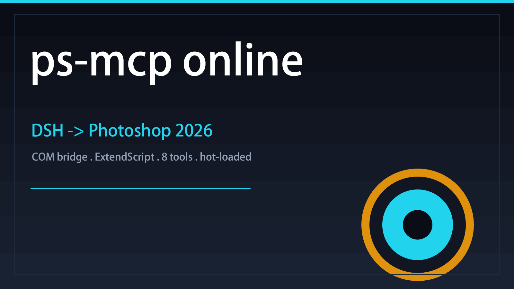

# AGENT-ADOBE-MCP

**Drive your local Adobe desktop apps from any MCP client — Photoshop, After Effects and Premiere Pro.**

[](LICENSE)
[](https://nodejs.org)
[](#requirements)
[](#what-is-in-the-box)

Three MCP servers that talk to the real applications on your machine:

| Package | App | Tools | Bridge | Latency |
|---|---|---|---|---|
| [`packages/photoshop`](packages/photoshop) | Photoshop | **23** | persistent COM bridge (`DoJavaScript`) | **50–90 ms** per call |
| [`packages/aftereffects`](packages/aftereffects) | After Effects | **20** | `AfterFX.exe -r` injection | **~700 ms** per call |
| [`packages/premiere`](packages/premiere) | Premiere Pro | **11** | CEP panel owning a local socket | **3–320 ms** per call |

Verified against **Photoshop 27.0**, **After Effects 26.0** and **Premiere Pro 26.0** on Windows. Every package has its own self-test that exercises each tool: `npm run selftest`.



---

## Why three different bridges

This is the interesting part, and it is not a stylistic choice. Each application exposes a different automation surface, and the surface decides the architecture.

**Photoshop** exposes a real COM automation object (`Photoshop.Application`) with `DoJavaScript`. So the server keeps **one** PowerShell process alive holding **one** COM connection and streams ExtendScript down a pipe. COM attach costs 44–78 ms once; after that a call is tens of milliseconds. Servers that spawn `cscript` per call take seconds — on Photoshop 2026 some of them stall for ~30 s.

**After Effects** does not. `AfterEffects.Project.26` resolves to a bare `IDispatch` with no members at all — `Get-Member` shows only the four .NET base methods. There is no scripting entry point on the COM object. So automation goes through the command line instead:

```
AfterFX.exe -r runner.jsx
```

Measured: **706 ms** when AE is already running (the flag injects into the live process — process count stays at 1), versus **12 358 ms** when AE has to start first. That is why the tools tell you to keep After Effects open.

The `-r` script also gets no stdout, no argv, and no environment from the caller. So each call writes its own directory with a runner whose job and result paths are baked in as absolute strings, and the result comes back as `key=value` lines that the server parses.

**Premiere Pro** has neither. No COM ProgID is registered for it, and there is no `-r` flag on the executable. It also has no timers — `setInterval`, `setTimeout` and `app.scheduleTask` are all absent, and `app.setTimeout` exists but never fires without user activity — so a startup script cannot poll for work either. The only path into its scripting engine from another process is a **CEP panel hosting a local socket**:

```
node index.mjs → TCP 127.0.0.1:3021 → CEP panel → CSInterface.evalScript → Premiere
```

The panel is the server and the MCP server is the client — the reverse of the other two packages. It also means **the panel must be opened once** (`Window → Extensions → AGENT-ADOBE-MCP Bridge`), and — the part that costs everyone an hour — **the `Extensions` submenu only exists while a project is open**. An empty Premiere shows no Extensions entry at all, which reads like CEP is unsupported. It is not.

---

## Requirements

| | |
|---|---|
| OS | Windows (all three apps are automated through Windows-only entry points) |
| Photoshop | Any version that registers `Photoshop.Application` — verified on **2026 (27.0)** |
| After Effects | Verified on **2026 (26.0)** |
| Premiere Pro | Verified on **2026 (26.0.0.72)**; needs its CEP panel installed once |
| Node | 18 or newer |
| PowerShell | Windows PowerShell 5.1 (built in) |

Check the Photoshop ProgID is registered:

```powershell
Get-ItemProperty 'Registry::HKEY_CLASSES_ROOT\Photoshop.Application\CLSID'
```

### After Effects needs one preference changed

`Preferences > Scripting & Expressions > Allow Scripts to Write Files and Access Network` must be **on**, otherwise every script that writes its result file fails with *permission denied*.

The preference lives in `%APPDATA%\Adobe\After Effects\<version>\Adobe After Effects <version> 设置.txt`:

```
"Pref_SCRIPTING_FILE_NETWORK_SECURITY" = "1"
```

Set it with the app closed, then start After Effects again. This repository's tools cannot work around it — the result file is the only return channel.

### Premiere Pro needs its panel installed and opened

```bash
npm run install:premiere      # copies the CEP panel, enables unsigned extensions
```

Then in Premiere: open a project, and choose `Window → Extensions → AGENT-ADOBE-MCP Bridge`. Leave it open — it owns the socket.

---

## Install

```bash
git clone https://github.com/HesperusHiacens/AGENT-ADOBE-MCP.git
cd AGENT-ADOBE-MCP
npm run selftest          # both packages; needs the apps installed
```

Nothing to build, nothing to `npm install`.

### Register with your MCP client

Each package ships an installer that writes the client config and backs up the old one.

```bash
# Photoshop
node packages/photoshop/scripts/install.mjs --target dsh      # or claude | cursor | vscode
node packages/photoshop/scripts/install.mjs --print           # just print the snippet

# Premiere Pro (installs the CEP panel, then open it once in Premiere)
node packages/premiere/scripts/install.mjs
```

For After Effects, copy the same shape and point `args` at
`packages/aftereffects/src/index.mjs`:

```json
{
  "mcpServers": {
    "photoshop": {
      "command": "C:\\Program Files\\nodejs\\node.exe",
      "args": ["D:\\path\\to\\AGENT-ADOBE-MCP\\packages\\photoshop\\src\\index.mjs"]
    },
    "aftereffects": {
      "command": "C:\\Program Files\\nodejs\\node.exe",
      "args": ["D:\\path\\to\\AGENT-ADOBE-MCP\\packages\\aftereffects\\src\\index.mjs"]
    }
  }
}
```

> Use an **absolute** `command`. Hosts launch MCP servers with a scrubbed environment, and some (DSH included) drop any variable whose name matches `TOKEN|KEY|SECRET|PASSWORD`, so `npx`/`node` may not resolve from `PATH`.

### Environment variables

| Variable | Package | Default | Meaning |
|---|---|---|---|
| `PS_PROGID` | photoshop | `Photoshop.Application` | COM ProgID; use a versioned one if several versions are registered |
| `PS_POWERSHELL` | photoshop | `%SystemRoot%\System32\WindowsPowerShell\v1.0\powershell.exe` | PowerShell executable |
| `PS_TIMEOUT_MS` | photoshop | `120000` | Per-call timeout |
| `PS_READY_TIMEOUT_MS` | photoshop | `180000` | COM attach budget |
| `AE_EXE` | aftereffects | auto-detected | Path to `AfterFX.exe` |
| `AE_TIMEOUT_MS` | aftereffects | `180000` | Per-call timeout |
| `AE_COLD_START_TIMEOUT_MS` | aftereffects | `180000` | Budget for the first call, when AE has to start |

---

---

## Trust model — read this before you wire it up

These servers are a **local automation bridge**, not a sandbox. Once an MCP client is connected, that client can:

| Capability | Which tools | Consequence |
|---|---|---|
| Run arbitrary ExtendScript | `ps_run_jsx` `ae_run_jsx` `pr_run_jsx` | Any file read or written, any API the host app exposes |
| Read any file on disk | `ps_open` `ae_import` `pr_import` | Whatever the running user can read |
| Write any file on disk | `ps_export` `ae_render` `pr_export` `ps_save` `ae_save_project` | Whatever the running user can write |
| Drive the app's UI state | everything | Save dialogs, preference changes, running actions |

The escape-hatch tools are deliberately part of the design — they are how you reach the 90% of each scripting DOM that no wrapper will ever cover. But it means **the security boundary is the MCP client, not this code**. Point it at a client and model you trust, on a machine you control.

### What is bounded

- **Network**: every server listens on `127.0.0.1` only, or uses stdio. Nothing is exposed to your LAN or the internet.
- **Dependencies**: there are none. No third-party package can be compromised to reach your machine through this project.
- **Shell**: no call uses a shell. Every subprocess is `spawn`/`execFile` with an argument array, so there is no command-injection path through tool arguments.

### What is not bounded, and you should know about

**The Premiere bridge needs a token, but a token is not a sandbox.** The CEP panel generates a random 192-bit token when it starts, writes it to `%LOCALAPPDATA%\agent-adobe-mcp\bridge.token`, and drops any connection that does not present it. That stops a stray process from driving Premiere by accident or opportunistically. It does not stop a process that already runs as you, because such a process can read the token file. A local bridge cannot do better than that — the honest boundary is "code running as your user", not "code you meant to run".

Verify it is enforced:

```powershell
# should come back as unauthorized
'{"id":1,"jsx":"app.version"}' | ncat 127.0.0.1 3021
```

**`PS_PROGID` is validated.** Only ProgIDs beginning with `Photoshop.` are accepted, at both the Node layer and inside the PowerShell bridge; anything else is rejected before a COM object is created, so the environment variable cannot be used to instantiate an unrelated COM server.

**Files are not sandboxed to a directory.** Pass absolute paths as you like; there is no allow-list. That is what makes `ps_export` useful, and it is also why the trust boundary has to be the client.

---

## What is in the box

### Photoshop — 23 tools

**Documents** `ps_ping` `ps_state` `ps_open` `ps_new_document` `ps_resize` `ps_crop` `ps_save` `ps_export` `ps_close`
**Layers** `ps_layers` `ps_text` `ps_select_layer` `ps_duplicate_layer` `ps_delete_layer` `ps_layer_mask` `ps_place` `ps_flatten`
**Colour** `ps_filter` (20 filters) `ps_adjust` (13 adjustments)
**Automation** `ps_run_jsx` `ps_play_action` `ps_history` `ps_batch`

`ps_run_jsx` is the whole Photoshop DOM — everything else is a shortcut for calls you make constantly.

### Premiere Pro — 11 tools

**Project** `pr_ping` `pr_state` `pr_list_sequences` `pr_list_media` `pr_list_tracks` `pr_save_project`
**Editing** `pr_new_sequence` `pr_import` `pr_add_to_timeline` `pr_export`
**Escape hatch** `pr_run_jsx`

### After Effects — 20 tools

**Project** `ae_ping` `ae_state` `ae_list_comps` `ae_new_comp` `ae_set_comp` `ae_save_project` `ae_output_templates` `ae_render`
**Layers** `ae_add_solid` `ae_add_text` `ae_add_shape` `ae_list_layers` `ae_set_layer` `ae_delete_layer` `ae_precompose` `ae_import`
**Animation** `ae_keyframe` `ae_add_effect` `ae_set_expression`
**Escape hatch** `ae_run_jsx`

---

## Three things that do not work, and why

This section exists because shipping a tool that silently does nothing is worse than not shipping it.

**1. `hue_saturation`, `vibrance`, `exposure` — not exposed at all.**
On Windows their only route is the Action Manager `setd` command, and Photoshop 2026 rejects it outright:

```
Error 8800: command "Set" is not currently available
```

This holds for every descriptor shape we tried — `T`/`Adjs`, `HStr`/`hueSaturation`, list vs object, background layer vs pixel layer. The DOM has no `adjustHueSaturation` either; `reflect.methods` on an ArtLayer lists exactly four adjustments: `adjustLevels`, `adjustCurves`, `adjustBrightnessContrast`, `adjustColorBalance`. So the other three are simply absent from `ps_adjust`, and this README says why.

**2. Layer masks have no DOM method.** `reflect.methods` contains no mask methods. The Action Manager route works, but only in one specific form — `Mk` with `Nw Chnl`, not `null`:

```javascript
var desc = new ActionDescriptor();
desc.putClass(charIDToTypeID("Nw  "), charIDToTypeID("Chnl"));
// ... putReference(At) + putEnumerated(Usng/UsrM/RvlA)
executeAction(charIDToTypeID("Mk  "), desc, DialogModes.NO);
```

**4. `app.project.createNewSequence()` deadlocks the ExtendScript engine (Premiere).**
It wants UI interaction and there is no UI in a socket call, so it blocks forever — with or without a valid preset. Afterwards even a one-line probe gets no answer until Premiere restarts. `pr_new_sequence` uses the QE DOM (`qe.project.newSequence`) instead, with a deliberately short 30 s timeout so a regression fails fast. QE's returned object also has no readable `name`, so the sequence is read back from `app.project.activeSequence`.

**3. `Document` has no `undo()` / `redo()`.** History is navigated by assigning `activeHistoryState`, which is what `ps_history` does.

---

## Troubleshooting

| Symptom | Cause / fix |
|---|---|
| `command "Fill" is not currently available` | The active layer is a **text** layer. Add a pixel layer and select it first: `var l = d.artLayers.add(); d.activeLayer = l;` |
| `command "Set" is not currently available` | The Action Manager `setd` command is unavailable on Photoshop 2026. Use the DOM methods the tools wrap |
| `Error 8103: the document has not yet been saved` | `d.fullName` throws on unsaved documents — wrap it in `try/catch` (the built-in tools do) |
| `Error 2: JSON is undefined` | ExtendScript has no `JSON`; use `psKV({...})` / `aeKV({...})` or return a string |
| `Array.indexOf is not a function` | ExtendScript is ES3. No `indexOf`, no `map`, no `JSON` — write plain `for` loops |
| `RPC_E_SERVERCALL_RETRYLATER` / `正在使用中` | Photoshop was briefly busy. The bridge retries with backoff; if it surfaces, dismiss the dialog |
| `Photoshop did not answer within Nms` | A modal dialog is open (Camera Raw, Save As, a script prompt). Dismiss it; the bridge reconnects on the next call |
| `bridge.ps1` fails to parse with a token error | It must stay **pure ASCII**: Windows PowerShell 5.1 reads `.ps1` as ANSI |
| After Effects: *permission denied* writing files | `Pref_SCRIPTING_FILE_NETWORK_SECURITY` is `0` — see above |
| After Effects: first call takes ~12 s | AE was not running. `-r` has to start it; later calls are ~0.7 s |
| After Effects: nothing appears on disk after a render | The output module format did not match the extension. Call `ae_output_templates` first |

Debugging order: `probe.mjs` (Photoshop COM only) → `selftest.mjs` (full MCP path) → the host.

---

## Design notes

- **One Photoshop COM connection, serialized calls.** Photoshop is single-threaded and `DoJavaScript` is not reentrant. A timeout kills the bridge; the next call re-attaches.
- **After Effects calls are serialized too.** `-r` injects into one shared process, so two concurrent jobs would overwrite each other's results.
- **stdout is protocol-only.** Every diagnostic goes to stderr.
- **ASCII-only PowerShell.** Non-ASCII bytes in `bridge.ps1` break the Windows PowerShell 5.1 parser.
- **No install-path guessing for Photoshop.** COM resolves the ProgID itself. After Effects *is* probed on disk, because there is no registry entry that points at `AfterFX.exe` reliably.

## Related

Adobe previewed **official local MCP integrations for Creative Cloud** at MAX 2026 (Photoshop, Illustrator, Premiere, After Effects), announced for private beta in early 2027. Until that ships, COM and the ExtendScript command line are the only ways to drive these apps locally.

## License

MIT — see [LICENSE](LICENSE).
